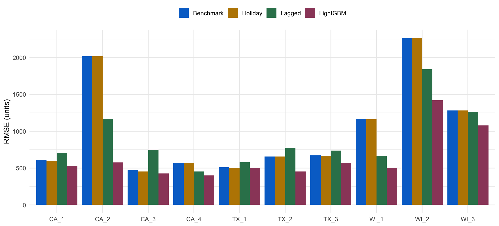
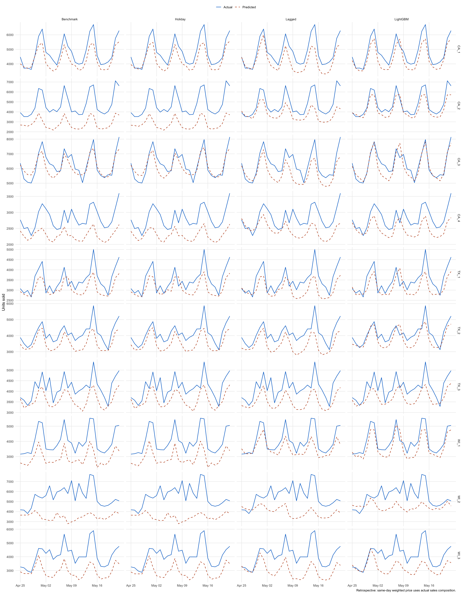

```{r}
#| include: false
library(dplyr)
out <- '../output/model_comparison'
read_result <- function(name) read.csv(file.path(out, paste0(name, '.csv')))
metrics <- read_result('metrics')
overall <- filter(metrics, store_id == 'Overall')
best <- overall$model[which.min(overall$RMSE)]
coefficients <- read_result('coefficients')
fits <- read_result('model_fit')
importance <- read_result('feature_importance')
timings <- read_result('timings')
stores <- sort(unique(coefficients$store_id))
fmt <- function(x) format(round(x, 2), nsmall = 2, big.mark = ',')
table <- function(x, digits = 3) knitr::kable(x, digits = digits)
```

```{=html}
<style>
body {color: #202a33; background: white;}
h1,h2,h3 {color: #075b9c; letter-spacing: 0;}
.important {border-left: 5px solid #d6a400; padding: 1rem; background: #fff9e5;}
.table-scroll {overflow-x: auto; margin-bottom: 1.5rem;}
table {font-size: 0.85rem;}
img {max-width: 100%; height: auto;}
pre {white-space: pre; overflow-x: auto;}
</style>
```

# Purpose and main result

We compare three additional specifications with our original OLS benchmark. The outcome is daily units sold across all products in one Walmart store. Each specification is fitted separately to ten stores. This phase asks whether better holiday timing, recent sales, or nonlinear relationships improve predictions enough to justify additional complexity.

**Lowest overall holdout RMSE: `r best`, at `r fmt(min(overall$RMSE))` units per store-day.** This is an observed result for one test window, not proof that the model is universally best. Positive percentage improvement means lower error than the benchmark; negative improvement means worse performance.

::: {.important}
**Retrospective, not a leakage-free forecast.** All four models use the same-day quantity-weighted price, including actual quantities from the test period. This preserves the assignment's agreed price convention, but the resulting RMSE is conditional on observed sales composition. The lagged models do not additionally use actual test sales as lag inputs. Their fixed-origin recursion does not remove the existing price-information limitation.
:::

# Data and evaluation design

The validated modeling dataset has 19,410 store-date observations, ten stores, and 1,941 dates per store. We preserve its weighted prices and all 24 carry-forward price imputations on zero-sales days. No raw files or original benchmark outputs are rewritten.

Training ends April 24, 2016 (1,913 days per store). The final holdout is April 25 through May 22, 2016 (28 days per store, 280 predictions per specification). Models requiring lags use 1,906 training observations because the first seven days have no seven-day lag.

Three expanding-window validation folds cover the last 84 training dates. Each model predicts all 28 validation days from the preceding origin. Folds are chronological, never randomly shuffled. Validation prices retain the same retrospective limitation as test prices.

```{r}
table(read_result('folds'))
```

LightGBM searches 12 configurations, with learning rate 0.05, 7 or 15 leaves, minimum leaf size 20 or 50, and 100, 300, or 600 boosting rounds. One configuration is chosen across all stores by pooled validation RMSE. Ties prefer fewer leaves, fewer rounds, then larger minimum leaf size. No final-holdout early stopping or tuning is performed. Seeds are fixed at 491 and LightGBM uses deterministic single-threaded fitting.

```{r}
table(read_result('selected_configuration'))
```

# What each model does

## Original OLS benchmark

Let $X_{st}$ contain weighted price, six weekday indicators (Monday reference), eleven month indicators (January reference), and the 30 named events already present in the benchmark. Both calendar event columns are checked. A non-event day has every event indicator equal to zero.

$$Q_{st}=\alpha_s+X_{st}'\beta_s+\varepsilon_{st}.$$

The original predictions are retained and a refit is checked against them. Consequently, our first improvement is not merely adding event indicators: they were already included.

## Model 1: Holiday-window OLS

For Christmas, Thanksgiving, Easter, Independence Day, Labor Day, and New Year, $H_t$ contains a separate indicator for days 1-3 before each holiday and another for days 1-3 after it. These 12 indicators supplement, rather than replace, the separate event-day indicators. Calendar windows may overlap, and dates are never duplicated.

$$Q_{st}=\alpha_s+X_{st}'\beta_s+H_t'\eta_s+\varepsilon_{st}.$$

Shopping may shift to the days around a holiday, so a same-day dummy can miss some associated demand. These windows are fixed economic choices, not chosen by searching the test outcomes. The holdout contains none of these six selected holiday windows; direct window effects therefore cannot explain holdout differences. Adding windows can still change other fitted coefficients. Year-round evaluation would be needed to assess their main purpose.

## Model 2: Lagged OLS

$$Q_{st}=\alpha_s+X_{st}'\beta_s+H_t'\eta_s+\rho_{1s}Q_{s,t-1}+\rho_{7s}Q_{s,t-7}+\varepsilon_{st}.$$

Yesterday's quantity captures recent demand, while the seven-day lag captures demand on the same weekday last week. The first holdout prediction uses historical sales for both lags. Later predictions use earlier predicted sales whenever the required lag lies inside the holdout. Errors can propagate through this recursion, making 28-day prediction harder than repeated one-day prediction with observed updates.

## Model 3: LightGBM

$$\widehat Q_{st}=f_s(X_{st},H_t,Q_{s,t-1},Q_{s,t-7}).$$

Gradient boosting builds a sequence of decision trees, with later trees correcting errors left by earlier ones. It can capture nonlinear price relationships and interactions without manually specifying every interaction. It uses exactly the lagged model's explanatory inputs, one-hot calendar encoding, and the same recursive prediction rule.

Makridakis, Spiliotis, and Assimakopoulos (2022) describe the strong performance of LightGBM-based approaches in M5. Our experiment is a simplified store-level application, not a replication of the competition's winning systems, product-level hierarchy, ensembling, or scoring. Success in that literature does not guarantee success here. Feature importance describes model usage, not causal importance.

# Prediction accuracy

RMSE is $\sqrt{\operatorname{mean}[(Q-\widehat Q)^2]}$. Overall RMSE pools all 280 errors; it is not the average of store RMSEs. MAE gives average absolute error. Mean error is actual minus predicted, so a positive value indicates underprediction. These metrics are measured in units sold, not dollars or percentages.

```{r}
table(select(overall, model, n, RMSE, MAE, mean_error, improvement_percent))
```

```{r}
#| results: asis
for (m in c('Holiday', 'Lagged', 'LightGBM')) {
  row <- filter(overall, model == m)
  wins <- sum(metrics$model == m & metrics$store_id != 'Overall' & metrics$improvement_percent > 0)
  cat(sprintf('\n- **%s:** pooled RMSE %s; %s%% improvement versus baseline; lower RMSE in %d of 10 stores.\n', m, fmt(row$RMSE), fmt(row$improvement_percent), wins))
}
```



```{r}
table(select(filter(metrics, store_id != 'Overall'), store_id, model, RMSE, MAE, mean_error, improvement_percent))
```

## Validation performance and tuning

Differences between these earlier windows and the final holdout help identify time-specific performance. We report every searched LightGBM configuration, including unsuccessful ones, rather than hiding models that do not improve the benchmark.

```{r}
table(read_result('validation_scores'))
table(read_result('tuning_scores'))
```

## Common-sample comparison

Benchmark and holiday OLS are also refitted without the first seven dates, matching the lagged model's sample. These diagnostic refits are not substitutes for the preserved original benchmark.

```{r}
table(filter(read_result('common_sample_metrics'), store_id == 'Overall'))
```

# Actual versus predicted sales

Every panel uses the same 28 dates. Individual store figures keep the same vertical scale across their four models. The overview allows different scales across stores, so visual amplitude should not be compared across store rows without checking axes. Negative predictions, if present, are retained rather than clipped.



```{r}
#| results: asis
for (s in stores) cat(sprintf('\n## %s\n\n\n\n', s, s, s))
```

# Coefficients and model interpretation

OLS coefficients are conditional associations, not causal effects or price elasticities. The weighted price can move because the product mix changes. Reported standard errors, t statistics, and p-values are conventional OLS quantities and do not correct for serial correlation or heteroskedasticity. Lag coefficients describe persistence conditional on the other predictors, not independently identified mechanisms.

```{r}
table(fits)
```

```{r}
#| results: asis
for (s in stores) {
  cat(sprintf('\n## %s coefficients\n\n', s))
  for (m in c('Benchmark', 'Holiday', 'Lagged')) {
    cat(sprintf('\n### %s\n\n<div class="table-scroll">\n\n', m))
    print(table(select(filter(coefficients, store_id == s, model == m), term, estimate, std_error, t_statistic, p_value)))
    cat('\n</div>\n\n')
  }
}
```

## LightGBM feature importance

The ten highest-gain features in each store are shown below. Gain measures improvement in the training objective from splits using that feature; it is not a regression coefficient or evidence of causality. Correlated features can share or displace importance. The complete ranking is saved separately.

```{r}
table(importance %>% group_by(store_id) %>% slice_max(Gain, n = 10, with_ties = FALSE) %>% ungroup())
```

# Was extra complexity worthwhile?

Holiday windows are easy to explain and inexpensive to fit, but their value should be judged in validation windows containing relevant holidays as well as this spring holdout. Lagged OLS adds only two coefficients but requires careful recursive prediction and has an error-propagation risk. LightGBM adds tuning and less transparent interactions; an accuracy gain must justify that burden. A worse result is still useful evidence and is retained in the report.

The numerical winner for this window is **`r best`**. This is a descriptive ranking, not a statistical significance test. We do not continue changing the specification after seeing the holdout. Broad claims about the best model require additional seasonal evaluation and a genuinely prospective price design.

The holiday model's roughly 0.2% pooled improvement is too small to support a strong practical claim for this particular holdout. Lagged OLS reduces pooled error by about 18%, but improves only five stores: a pooled gain does not imply a gain everywhere. LightGBM improves all ten stores and lowers pooled error by about 40%, making its extra complexity promising in this experiment. Its selected configuration also has lower pooled error than the other specifications in each validation fold, although those folds were used to select it and therefore are not an independent final test. All four models still underpredict on average; LightGBM reduces, but does not eliminate, that bias.

```{r}
table(timings %>% group_by(model) %>% summarise(fit_seconds = sum(fit_seconds), predict_seconds = sum(predict_seconds), .groups = 'drop'))
```

Times cover final fitting and prediction across ten stores, not the full tuning search. Benchmark timing is measured using its verified reproduction; predictions in the comparison remain the saved originals. Execution times depend on the computer and are not stable model properties.

# Validation and final-report notes

```{r}
table(read_result('validation'))
```

- Quantities, price imputations, the original benchmark, and raw datasets are preserved.
- Sales lags are store-specific and chronological. A hand-calculated recursion example produces 8, 10, and 13 from a starting history of 1 through 7.
- Replacing holdout quantities and precomputed holdout lags with an extreme placeholder leaves predictions unchanged when prices are held fixed. This isolates lag handling; it does not certify the price predictor as leakage-free.
- Every OLS fit must have full column rank. Every final model must produce 28 finite predictions per store.
- Metrics are independently recomputed from saved actual and predicted quantities rather than trusting saved error columns.
- No trend, SNAP variables, outlier removal, or additional outcome-driven model selection is introduced. LightGBM can learn interactions implicitly.
- The same-day price rule is the major forecasting limitation. Future work should determine weights and future prices without using the quantities being predicted.
- This phase does not update the final presentation or claim a causal effect of price, holidays, or recent demand.

# Reproduce the comparison

Run from the repository root, after the original baseline outputs have been created:

```bash
Rscript -e 'install.packages(c("dplyr", "tidyr", "ggplot2", "lightgbm"), repos="https://cloud.r-project.org")'
Rscript scripts/05_model_comparison.R
quarto render report/walmart_model_comparison.qmd
```

LightGBM models are saved in their native text format; OLS models are saved as R objects. The output folder also contains the augmented dataset, all validation predictions, selected configuration, final predictions, coefficients, metrics, audit results, and figures. The lag columns saved for test rows are descriptive only: the recursive forecaster always overwrites them with forecast-origin-safe values.

## Complete executable R code

```{r}
#| results: asis
cat('\n```r\n', paste(readLines('../scripts/05_model_comparison.R'), collapse = '\n'), '\n```\n', sep = '')
```

## Software versions

```{r}
#| results: asis
cat('\n```text\n', paste(readLines(file.path(out, 'session_info.txt')), collapse = '\n'), '\n```\n', sep = '')
```

# Reference

Makridakis, S., Spiliotis, E., & Assimakopoulos, V. (2022). M5 accuracy competition: Results, findings, and conclusions. *International Journal of Forecasting, 38*(4), 1346-1364. <https://doi.org/10.1016/j.ijforecast.2021.11.013>
