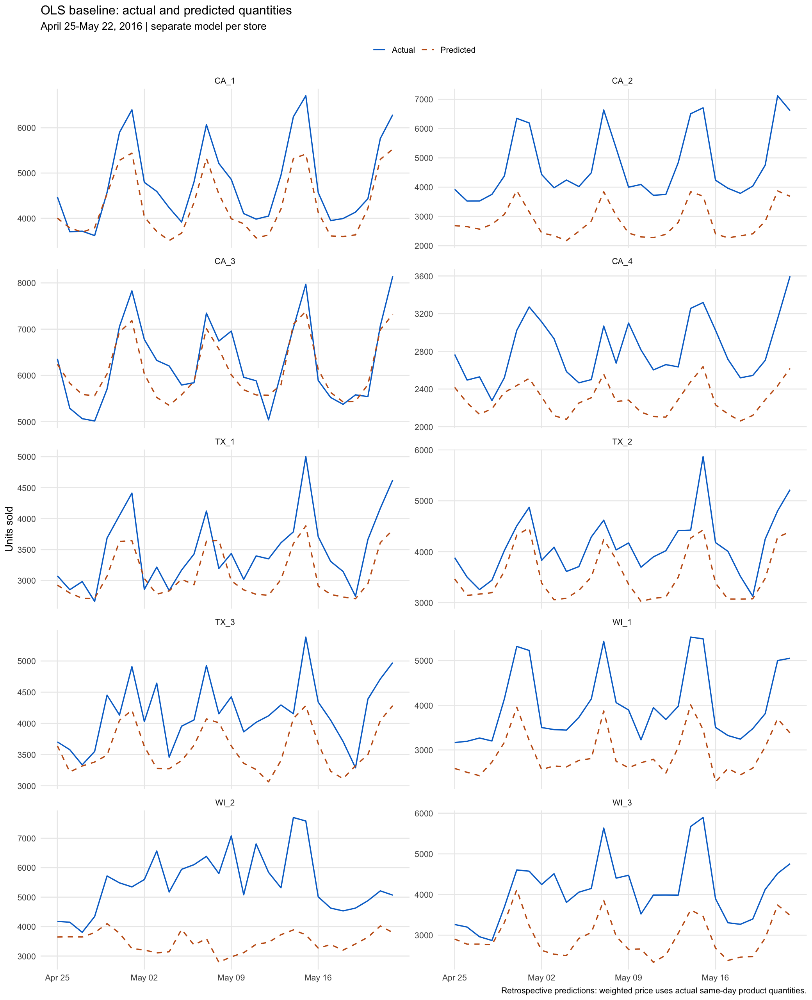

```{r}
#| label: setup
#| include: false
out <- "../output/ols_baseline"
required <- c("rmse.csv", "predictions.csv", "coefficients.csv", "model_fit.csv", "validation.csv")
stopifnot(all(file.exists(file.path(out, required))))
read_output <- function(name) read.csv(file.path(out, name), check.names = FALSE)
scores <- read_output("rmse.csv")
predictions <- read_output("predictions.csv")
coefficients <- read_output("coefficients.csv")
fits <- read_output("model_fit.csv")
mean_comparison <- aggregate(cbind(actual, predicted, error) ~ store_id, predictions, mean)
checks <- read_output("validation.csv")
events <- read_output("event_dictionary.csv")
imputed <- read_output("price_imputations.csv")
stores <- sort(unique(predictions$store_id))
overall <- scores$RMSE[scores$store_id == "Overall"]
fmt <- function(x) format(round(x, 2), big.mark = ",", nsmall = 2)
```

```{=html}
<style>
body {color: #202a33; background: white;}
h1,h2,h3 {color: #075b9c; letter-spacing: 0;}
.important {border-left: 5px solid #e3ad19; padding: 1rem 1.3rem; background: #fff8df; margin: 1rem 0;}
.equation {padding: 1rem; border-left: 4px solid #0071ce; background: #eef6fc; font-size: 1.1rem;}
.regression-table {overflow-x: auto; margin: 1rem 0 2rem;}
.regression-table table {min-width: 650px; width: 100%; font-size: 0.85rem;}
.regression-table td {padding: 0.2rem 0.45rem;}
pre {max-height: none;}
img {max-width: 100%; height: auto;}
</style>
```

# Assignment overview

We estimate one ordinary least squares (OLS) regression for each of the ten Walmart stores. The outcome is the total number of units sold by a store on a date, summed across all products. This intentionally simple first model includes price and calendar indicators. Its purpose is to establish a baseline for later comparisons, not to select a final forecasting model.

**Overall holdout RMSE: `r fmt(overall)` units sold per store-day**, calculated across 280 predictions. The error is measured in units, not dollars or percentages. It is not an error measure for the chain-wide daily total.

::: {.important}
**Retrospective evaluation.** The selected weighted price uses the quantities actually sold on the same date, including dates in the test period. Those quantities would not be known at a genuine forecast origin. The coefficients are fitted using training rows only, but the test predictor still contains information from actual test outcomes. Consequently, this RMSE describes retrospective predictions conditional on observed sales composition. It should not be presented as leakage-free forecasting performance.
:::

# Data and weighted price

The inputs are the product-level sales train/test files, calendar, weekly item prices, and the existing prepared store-day totals. The original training file covers `d_1` through `d_1913`; the test file covers `d_1914` through `d_1941`. Product identifiers are checked before the consecutive day columns are combined.

Prices are matched using **store, product, and retail week**. The calendar supplies the retail week for each daily observation. For store *s* on day *t*, weighted price is:

<div class="equation">P<sub>st</sub> = &Sigma;<sub>i</sub>(q<sub>ist</sub> &times; p<sub>ist</sub>) / &Sigma;<sub>i</sub>q<sub>ist</sub></div>

This is the average listed price per unit sold across that store's product mix. It can change because product prices change or because customers purchase a different mix of products. It is not a fixed-basket price index, and its coefficient is not a causal price elasticity.

Products with zero quantity contribute zero. Every product with positive quantity must have a valid positive price; missing positive-sales prices cause the script to stop rather than silently discard sales. The competition scoring weights file is not used.

There are **`r nrow(imputed)` zero-sales store-days**, all of which are retained. Their weighted-price denominator is zero, so the previous available weighted price for that store is carried forward. The raw undefined value and an imputation flag remain in the modeling dataset. These replacements are a documented convention, not observed transaction prices.

# Training and test split

| Sample | Start | End | Days per store | Store-day rows |
|:--|:--|:--|--:|--:|
| Training | January 29, 2011 | April 24, 2016 | 1,913 | 19,130 |
| Test | April 25, 2016 | May 22, 2016 | 28 | 280 |

The same cutoff is used for every store. Models are fitted once using training observations; the test observations are used to calculate predictions and errors, with the price-information limitation described above.

# Regression equation

<div class="equation">Q<sub>st</sub> = &alpha;<sub>s</sub> + &beta;<sub>s</sub>P<sub>st</sub> + &Sigma;<sub>k &ne; Monday</sub>&gamma;<sub>sk</sub>D<sub>kt</sub> + &Sigma;<sub>m &ne; January</sub>&delta;<sub>sm</sub>M<sub>mt</sub> + &Sigma;<sub>e</sub>&theta;<sub>se</sub>E<sub>et</sub> + &epsilon;<sub>st</sub></div>

- **Q:** total daily quantity sold; **P:** same-day quantity-weighted price.
- **Weekday indicators:** six indicators, with Monday omitted.
- **Month indicators:** eleven indicators, with January omitted.
- **Event indicators:** one per named event observed in training. Both event-name columns are checked, and two events on one date activate both indicators. An ordinary non-event day has all event indicators equal to zero.
- **Store-specific coefficients:** each store has its own intercept, price relationship, and calendar associations.

There are `r nrow(events)` named event indicators. No trend, lagged sales, SNAP terms, interactions, outlier removal, or model selection are included. The intercept describes a Monday in January without a listed event at price zero, so it is mainly a regression reference rather than a realistic standalone sales prediction. Each calendar coefficient represents a difference from its reference holding the other included variables constant. Conventional OLS standard errors and p-values are reported; serial correlation, heteroskedasticity, and the construction of weighted price limit inferential interpretation.

# Coefficients and model fit

The following fit statistics describe training performance. They are distinct from holdout RMSE.

```{r}
knitr::kable(fits, digits = 3)
```

Each Stargazer coefficient entry reports the estimate, standard error, t statistic, and p-value in that order. Full-precision results are also saved in `coefficients.csv`. Small p-values displayed as zero reflect rounding.

## Stores 1-5

Columns (1)-(5): **CA_1, CA_2, CA_3, CA_4, TX_1**, respectively.

```{r}
#| results: asis
cat('<div class="regression-table">\n', paste(readLines(file.path(out, "tables/coefficients_group_1.html")), collapse = "\n"), '\n</div>\n')
```

## Stores 6-10

Columns (1)-(5): **TX_2, TX_3, WI_1, WI_2, WI_3**, respectively.

```{r}
#| results: asis
cat('<div class="regression-table">\n', paste(readLines(file.path(out, "tables/coefficients_group_2.html")), collapse = "\n"), '\n</div>\n')
```

# Actual and predicted quantities

Blue solid lines show actual quantities and orange dashed lines show retrospective OLS predictions. Each panel contains the same 28 dates. Panel scales differ to keep within-store discrepancies readable; use the individual graphs below for closer inspection. Negative predictions, if any, remain unchanged and are flagged in the saved prediction data.

{fig-alt="Ten store panels comparing actual quantities with retrospective OLS predictions over April 25 to May 22, 2016."}

# RMSE

<div class="equation">RMSE = &radic;[mean((actual quantity &minus; predicted quantity)<sup>2</sup>)]</div>

```{r}
knitr::kable(scores, digits = 2, col.names = c("Store", "Test observations", "RMSE (units)"))
```

The overall value uses all 280 squared errors before taking the square root; it is not the arithmetic average of the ten store RMSEs. A smaller RMSE indicates smaller errors for the same target and evaluation sample. Comparisons across stores also reflect their different sales volumes. This first value becomes useful when later models are evaluated under a consistent information set and weighting policy.

## What this first model shows

All ten stores have positive mean errors (actual minus predicted), meaning the model underpredicts their average sales during this holdout period. WI_2 and CA_2 have the largest RMSEs; CA_3 has the smallest. The model includes recurring calendar patterns but no explicit trend, so it cannot separately represent a gradual change in the sales level. This is one possible explanation to investigate later, not a demonstrated cause of the errors or a reason to modify this first specification after viewing the test results.

```{r}
knitr::kable(mean_comparison, digits = 2,
  col.names = c("Store", "Mean actual", "Mean predicted", "Mean error (actual - predicted)"))
```

Eight of the ten fitted weighted-price coefficients are positive. This does not imply that raising prices causes customers to buy more units. The predictor is an average over the products actually purchased, and both product composition and omitted time-related factors can affect its association with quantity. This is another reason to interpret this exercise descriptively.

# Individual store results

```{r}
#| results: asis
for (s in stores) {
  cat("\n## ", s, "\n\n", sep = "")
  cat("Holdout RMSE: **", fmt(scores$RMSE[scores$store_id == s]), " units**.\n\n", sep = "")
  cat("\n\n", sep = "")
  cat('<div class="regression-table">\n', paste(readLines(file.path(out, "tables", paste0("coefficients_", s, ".html"))), collapse = "\n"), '\n</div>\n')
}
```

# Validation and notes for the final report

```{r}
knitr::kable(checks)
```

Price coverage by store:

```{r}
knitr::kable(read_output("price_coverage.csv"))
```

All recomputed daily quantities must agree with the existing prepared totals. The script checks join uniqueness, uninterrupted store-date coverage, valid contributing prices, price bounds, carry-forward replacements, model rank, and finite predictions. It independently recomputes each RMSE from the saved prediction file.

Record these choices when writing the final report:

1. This baseline has separate store models and the same date split throughout.
2. Same-day quantity weighting was selected for this assignment. Test quantities enter price; this is a retrospective exercise. Future forecasting should use weights and price information available at the forecast origin.
3. Weighted price combines price and product-mix variation and is jointly related to quantity. Coefficients describe associations, not causal demand responses.
4. Zero-sales Christmas rows are retained with flagged carried-forward prices. OLS predictions are not truncated.
5. Event indicators are named-event indicators, not event-type indicators. Multiple events can coexist on a date.
6. Training fit statistics do not establish forecast accuracy. Holdout RMSE is measured in store-day units, and one holdout period does not establish robustness across time.
7. Later improvements may address the trend, dynamic dependence, uncertainty, and valid future price construction; none is selected using this test period in this baseline.

## Event dictionary

```{r}
knitr::kable(events)
```

## Zero-sales price replacements

```{r}
knitr::kable(imputed[c("store_id", "date", "total_quantity", "weighted_price", "price_imputed")], digits = 4)
```

# Reproduce the assignment

Run these commands from the repository root. Install the required R packages once if needed.

```{.r}
install.packages(c("dplyr", "tidyr", "ggplot2", "stargazer", "knitr", "rmarkdown"))
source("scripts/04_ols_baseline.R")
```

Then render the report:

```{.bash}
quarto render report/walmart_ols_baseline.qmd
```

The script saves its results under `output/ols_baseline/`. Rendering reads those saved outputs without refitting. The R script and this HTML report provide the code and results needed for the assignment.

## Complete executable R code

```{r}
#| results: asis
cat("\n```r\n", paste(readLines("../scripts/04_ols_baseline.R"), collapse = "\n"), "\n```\n", sep = "")
```

## R environment

```{r}
#| results: asis
cat("\n```text\n", paste(readLines(file.path(out, "session_info.txt")), collapse = "\n"), "\n```\n", sep = "")
```
